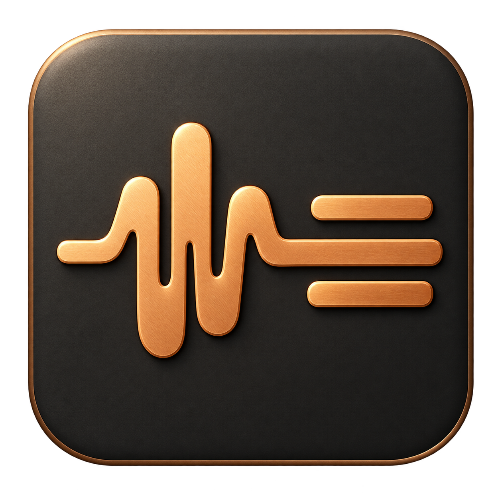

  

# Step to Transcriber

**Превращаем звук в слова.**

Расшифровывайте аудио, видео и прямые эфиры на компьютере с Windows. Приложение распознаёт речь локально, показывает текст в окне и сохраняет его в Markdown или TXT. Интерфейс доступен на русском и английском.

## Установка

Для распознавания нужна видеокарта **NVIDIA** с драйвером, совместимым с CUDA 12.9. Сборка предназначена для Windows x64. Установку и расшифровку файла проверили на Windows 11. Зависимости приложения уже входят в установщик.

1. Откройте файл `Step-to-Transcriber-<версия>-Windows-x64-Setup.exe`. В локальной сборке он находится в папке `dist`. После публикации файл появится в разделе **Releases** на GitHub.
2. Пройдите шаги мастера. При желании отметьте создание ярлыка на рабочем столе.
3. Откройте **Step to Transcriber** из меню **Пуск**.

При первом использовании модели приложение скачает её с Hugging Face. Для этого нужны интернет и несколько гигабайт свободного места. После загрузки модели локальные файлы можно расшифровывать офлайн.

## Первая расшифровка

1. Выберите **Файл на компьютере** и укажите аудио или видео. Можно также перетащить файл в окно.
2. Нажмите **Расшифровать**. Приложение определит язык речи. Если в записи несколько аудиодорожек, нужную можно выбрать перед запуском.
3. На экране **Расшифровка закончена** скопируйте текст или откройте папку через значки над результатом.

Поддерживаемые форматы файлов — MP4, MKV, MOV, WEBM, MP3, WAV, M4A, FLAC, OGG и OPUS.

## Другие источники

### Видео по ссылке

Выберите **Ссылка на видео**, вставьте адрес конкретного ролика или сохранённого эфира и нажмите **Расшифровать**. Приложение принимает ссылки на ролики YouTube, VK Видео и Rutube, а также на записи эфиров Twitch и VK Видео Live. Доступность загрузки зависит от сайта и самой записи.

### Прямой эфир или вебинар

1. Выберите **Прямой эфир**. Оставьте **Windows по умолчанию** или укажите наушники либо колонки, в которых слышен эфир.
2. Нажмите **Начать расшифровку** и включите воспроизведение. Текст появится с небольшой задержкой после подготовки модели.
3. Нажмите **Остановить**, чтобы обработать оставшийся звук. При включённом автосохранении текст записывается по ходу сеанса.

Приложение слышит всё, что воспроизводится на выбранном выходе Windows, включая уведомления. Микрофон попадёт в расшифровку, если его звук воспроизводится на этом выходе. Через кнопку **Открыть в отдельном окне** можно держать текст рядом с трансляцией.

## Результаты и настройки

| Что сделать | Где это настроить |
| --- | --- |
| Сохранить TXT, Markdown или оба файла | **Формат результата** перед запуском. По умолчанию выбран Markdown. |
| Включить или убрать время начала абзацев | **Дополнительные настройки → Таймкоды** для файла или ссылки. Таймкоды также можно переключить над готовым результатом. Для эфира настройте их до начала сеанса. |
| Сохранить результат в другую папку | **Дополнительные настройки → Папка результатов** для файла или ссылки. В эфире поле видно на основном экране. |
| Перетащить готовый файл в другое приложение | Используйте значок **Поделиться файлом** над текстом. |
| Переключить язык или тему интерфейса | Ручка **RU / EN** справа сверху меняет язык, **DARK / LIGHT** меняет тему. |

Папка по умолчанию — `%LOCALAPPDATA%\Step to Transcriber\output`. Приложение запоминает последнюю выбранную папку. Нажмите **F11**, чтобы включить полноэкранный режим или вернуться обратно.

## Если что-то не получается

- **Долго загружается модель.** При первом использовании проверьте интернет и свободное место на диске.
- **Ошибка CUDA или памяти GPU.** Проверьте, что Windows видит видеокарту NVIDIA и установлен подходящий драйвер. Закройте приложения, которые сильно нагружают видеокарту. Для файла или ссылки выберите **turbo**, если ранее переключились на **large-v3**.
- **Видео по ссылке не загружается.** Проверьте, открывается ли запись в браузере без входа в аккаунт. Используйте адрес одного видео. Для текущего эфира выберите **Прямой эфир**. Если запись уже есть на диске, откройте её как локальный файл.
- **В эфире нет текста.** Проверьте, слышна ли речь на выбранных наушниках или колонках. Если нужного устройства нет в списке, нажмите **Обновить** перед началом сеанса.

## Удаление

Закройте приложение. В Windows откройте **Параметры → Приложения → Установленные приложения**, найдите **Step to Transcriber** и нажмите **Удалить**. Расшифровки, настройки, журналы и загруженные модели сохранятся.

---

[Техническая документация для разработчиков](docs/DEVELOPMENT.md) · [Steptovictory на GitHub](https://github.com/steptovictory-dev)
